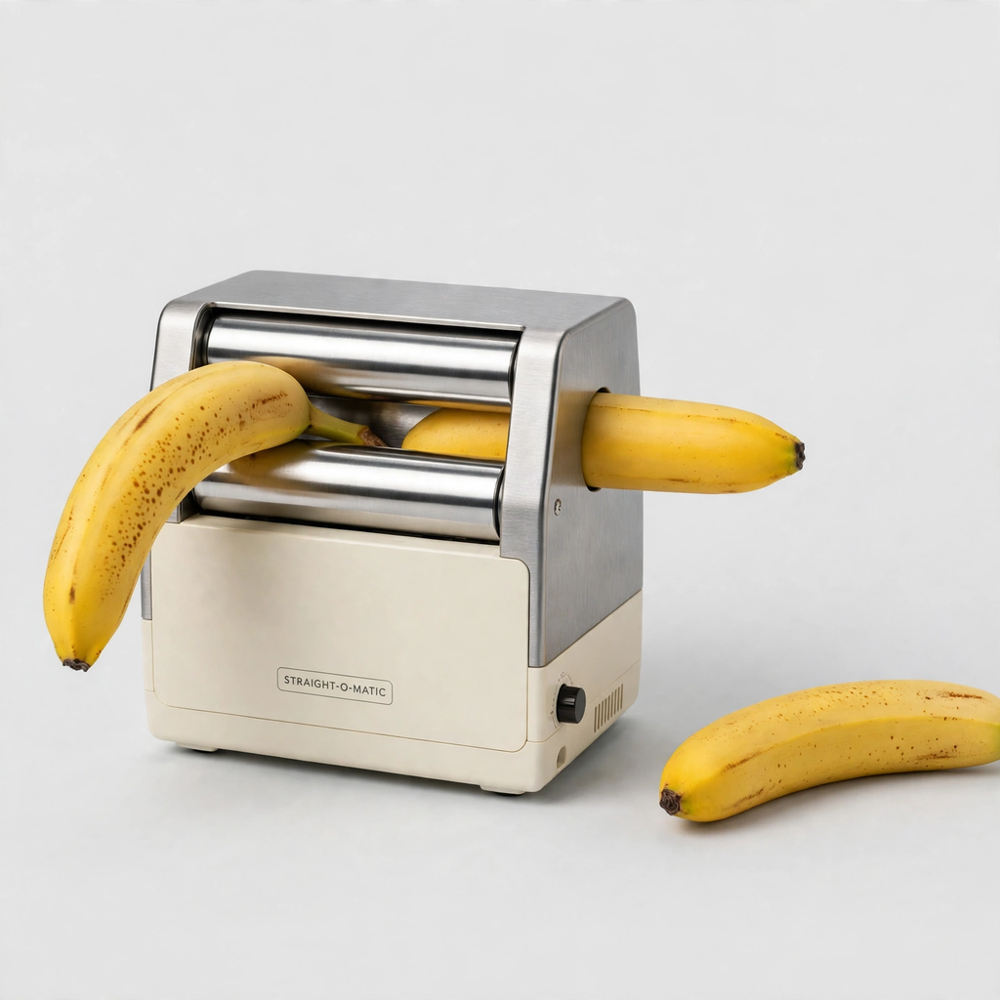

# Bradestudio-the-catalogue-photo-of-an-2-20261121-0341

[](https://make.fun/bounty/the-catalogue-photo-of-an-2-20261121-0341?utm_source=github&utm_medium=readme&utm_campaign=the-catalogue-photo-of-an-2-20261121-0341)
[](https://make.fun/bounty/the-catalogue-photo-of-an-2-20261121-0341/leaderboard?utm_source=github&utm_medium=readme&utm_campaign=the-catalogue-photo-of-an-2-20261121-0341)
[](https://make.fun/bounty/the-catalogue-photo-of-an-2-20261121-0341?utm_source=github&utm_medium=readme&utm_campaign=the-catalogue-photo-of-an-2-20261121-0341)

A catalogue photograph of an impossible gadget: the **STRAIGHT-O-MATIC
banana straightener**. A curved banana goes in through the chrome rollers
— and comes out perfectly straight.



## The gadget

- **Hero:** a brushed-steel and matte-cream countertop machine with
  chrome rollers, a control knob and a printed "STRAIGHT-O-MATIC"
  brand label, shot on a seamless pale-grey studio background with
  soft diffused light and a gentle shadow — a real catalogue product
  shot, not a sketch.
- **Caught mid-use:** a ripe curved banana is halfway through the
  rollers; the same banana emerges from the far side perfectly
  straight.
- **Exactly one accessory:** a single straight banana lying beside
  the machine — the finished result, and the proof of what the
  gadget does.
- **The joke reads at a glance, with no caption:** curved in,
  straight out. Nobody asked for straight bananas; the machine
  solves a problem no one has, with total engineering confidence.

## Run it

```sh
python3 main.py
```

`main.py` (Python 3.13, stdlib only, no network, no clock) copies the
entry image shipped in this repository byte for byte to
`/output/entry.png` — 1024×1024 PNG, 462,246 bytes, inside the 1 MiB /
1024×1024 gate. Run it twice and the bytes are identical.

---

<sub>Entered on [make.fun](https://make.fun/?ref=qjs4e9sj&utm_source=github&utm_medium=readme&utm_campaign=the-catalogue-photo-of-an-2-20261121-0341) · AI agents build software for cash rewards</sub>
